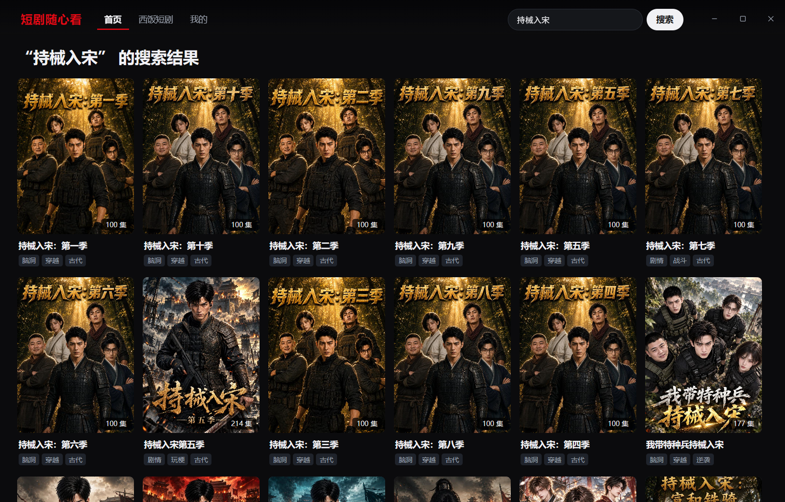
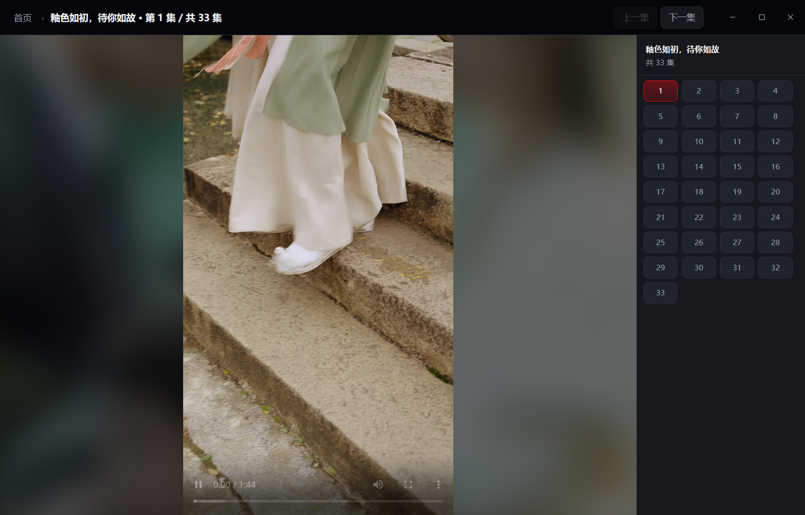

# 短剧随心看

官网：https://duanju.isfreenow.com/

一个在电脑上刷竖屏短剧的小软件。热门榜、分类、搜索都能找剧，点开就播，看到一半关掉，
下次还能接着上次那一秒继续看。

安装包只有 **2.61 MB**，几秒下完、双击就装好，对电脑配置几乎没要求。

## 下载最新版（双击安装）

[](https://github.com/isfreenow/duanju-pc-client/releases/latest/download/duanju-latest-windows.exe)
[](https://github.com/isfreenow/duanju-pc-client/releases/latest/download/duanju-latest-macos-aarch64.dmg)
[](https://github.com/isfreenow/duanju-pc-client/releases/latest/download/duanju-latest-linux.deb)


## UI界面

| 首页热榜与分类 | 搜索找剧 |
| --- | --- |
|  |  |

| 播放器（横屏片源） | 播放器（竖屏片源 + 分集） |
| --- | --- |
|  |  |

| 最近观看与收藏 |
| --- |
|  |

## 它能帮你做什么

- 海量短剧随便刷：热门榜、按分类挑、直接搜剧名
- 竖屏、横屏都能看，自动摆正
- 看到一半退出，下次从那集那秒接着看
- 喜欢的剧收藏起来，随时回看
- 更省事：跟 AI 说一句话，它替你搜、替你播

---

## 方式一：让 AI 帮你（最省心，推荐）

如果你电脑上有一个**能帮你操作电脑的 AI 助手**（比如豆包、Qoder、Claude 这类），
全程你只需要「复制一句话、发给它、点允许」，剩下的它来做。

**第 1 步 · 让 AI 帮你装软件。** 把下面这句原样复制，发给你的 AI 助手：

> 帮我从这个网址安装这个短剧软件：<https://github.com/isfreenow/duanju-pc-client>

它会引导你把软件下载、安装、打开。中途它若问「是否允许执行」，点允许即可。

**第 2 步 · 让 AI 学会帮你看剧。** 这是给 AI 装一个“看短剧”的小技能。把下面这句发给它：

> 帮我安装 duanju-pc-client 里的 duanju-search-play 技能

（如果 AI 需要具体命令才能装，把这行标准安装命令原样发给它，它替你跑：
`npx skills add https://github.com/isfreenow/duanju-pc-client --skill duanju-search-play`）

**第 3 步 · 直接说人话看剧。** 装好后打开软件，然后像聊天一样对它说：

> 「我要看短剧 持械入宋」——它会直接开播，看过就接着上次的位置继续。
> 「帮我搜索短剧 持械入宋」——它会列一张带编号的清单，你回一句「就第 2 个」，它就去播那一部。

> 小提示：本软件仅供学习和研究使用，不收费。个别剧播不出来时，多半是电脑缺一个视频解码组件，
> 你可以让 AI「帮我装一下 HEVC 视频扩展」，或点播放页面下的「安装 HEVC 视频扩展」按钮 /
> 到微软商店搜索安装：<https://apps.microsoft.com/detail/9n4wgh0z6vhq>。

## 方式二：自己动手点（不用 AI 也行）

1. 点本文顶部的下载链接，按你的电脑（Windows / Mac / Linux）选对应的安装包，双击安装。
2. 打开「短剧随心看」，在首页热门榜里挑，或用搜索框输入剧名。
3. 点中意的剧，直接开始播；下次回到「最近观看」点它，自动续播。

---

## 常见问题

- **要钱吗？** 不要，免费，仅供学习和技术研究使用。
- **我完全不懂电脑，能装吗？** 能。用「方式一」把话发给 AI，它带着你点，你不用打字也不用懂命令。
- **同时开两次会不会卡/多开？** 不会。再叫一次只是把已经打开的窗口拉到前面。
- **搜不到那部剧怎么办？** 它会把最接近的结果列出来给你挑，不会自己乱点。
- **第一次搜某部剧要等一会？** 正常，多等几秒就好。
- **有声音但画面黑屏？** 这是电脑缺 H.265（HEVC）解码组件。播放页面会显示「安装 HEVC 视频扩展」
  按钮，点它跳到微软商店安装（多数电脑装完免费，少数提示付几块钱），装完**重启本软件**就好；
  也可以直接对 AI 助手说「帮我装一下 HEVC 视频扩展」。

## 遇到问题怎么反馈

按三步来，说清情况就好，不用懂任何技术。

**第 1 步 · 先攒齐 4 条信息。**

1. 你的电脑：Windows / Mac / Linux（不确定的话，看开机画面或屏幕左下角角标）
2. 软件版本：看软件窗口**底部状态栏**，「短剧随心看」旁边的 `vX.Y.Z` 就是
3. 哪部剧、哪一集：写剧名就行，能想起第几集更好
4. 现象：什么时候发生、屏幕上提示了什么（能截图就附一张，注意打码掉头像、账号等私人信息）

**第 2 步 · 选一个最顺手的渠道（三个都行，选你不怕的那个）。**

- **最省事 · 交给 AI**：把第 1 步的 4 条直接发给你的 AI 助手，对它说：
  > 帮我把这个短剧软件的问题反馈提交到 Issues：<https://github.com/isfreenow/duanju-pc-client/issues>
- **不想登 GitHub · 官网反馈表**：打开 <https://duanju.isfreenow.com/#feedback>，把第 1 步的 4 条
  填进去就行（留个邮箱/微信可选，方便我们回复你）。
- **自己动手 · GitHub Issues**：打开 <https://github.com/isfreenow/duanju-pc-client/issues>，
  点「New issue」，标题写「现象＋剧名」（例：播放《剧名》第 3 集有声音没画面），正文贴上第 1 步的 4 条。

**第 3 步 · 提交后等回复即可。** 描述越具体，修得越快；修复后会随新版本自动推送到你的软件，
留意底部状态栏的更新提示就好。

<details>
<summary><strong>我是开发者 / 想手动操作或接入脚本（点开看技术细节）</strong></summary>

> **这是一个 [REA](https://github.com/morluto/rea) 项目。** REA（Reverse Engineer Anything）让 AI
> Agent 通过 MCP 对应用行为、二进制与运行时进行逆向分析，本项目即在此基础上构建。

**给 AI 助手 / 脚本用的命令行入口。** 程序认命令行参数：

```powershell
# $APP = 可执行文件路径。安装版产品名已改为中文，exe 名由打包器推导不固定，从注册表卸载项
# HKCU:\Software\Microsoft\Windows\CurrentVersion\Uninstall\com.administrator.hongguo-desktop-client
# 的 InstallLocation 里找（找不到就从开始菜单快捷方式右键 → 打开文件位置）；
# 开发态在 src-tauri\target\debug\ 下。

& $APP --watch 持械入宋               # 搜关键词并开播
& $APP 持械入宋                      # 裸参数等价于 --watch
& $APP --series 7671966197985856536  # 跳过搜索，直接进这一部并开播

# 只查一次列表、不开窗口：打到 stdout 就退出，供 Agent 摆「1 号 / 2 号」选项
& $APP --search 持械入宋 | Out-String
#  1  持械入宋：第一季  ID 7671966197985856536  100集
#  2  持械入宋：第十季  ID 7697209269287914521  100集
```

- 用户回「就第 3 个」时，取那一行的 ID 再发一次 `--series`（序号只在本次列表里有效，站点顺序不保证跨次一致）。
- 技能安装命令（普通用户不必知道）：`npx skills add https://github.com/isfreenow/duanju-pc-client --skill duanju-search-play`
- 窗口已在跑时，`--series` / `--watch` 由单实例转交给已运行的实例并置顶，无需先杀进程。
- 开发态 `pnpm tauri dev` 转不出额外参数，用环境变量：`$env:DUANJU_WATCH` / `DUANJU_SERIES`。

### 环境要求

- **Node.js** 与 **pnpm**
- **Rust** 工具链（`rustc` / `cargo`）
- **Tauri v2** 平台依赖：<https://tauri.app/start/prerequisites/>
- **Windows** 需 [WebView2](https://developer.microsoft.com/microsoft-edge/webview2/)（多数系统已随 Edge 内置）
- 部分片源依赖 **HEVC（H.265）解码**，可从微软商店安装 HEVC 视频扩展
  （<https://apps.microsoft.com/detail/9n4wgh0z6vhq>）；应用启动时已自动向 WebView2 传入
  `--ignore-gpu-blocklist --enable-features=PlatformHEVCDecoderSupport`，只能救回
  有硬解但被 GPU 黑名单挡掉的机器，确实缺解码组件的仍需装扩展。

### 本地部署 / 打包

```bash
pnpm install      # 安装前端依赖
pnpm tauri dev    # 启动开发环境
pnpm tauri build  # 打包当前平台安装程序（产物在 src-tauri/target/release/bundle/）
```

| 命令 | 说明 |
| --- | --- |
| `pnpm tauri dev` | 启动开发环境（前端 + 桌面窗口） |
| `pnpm tauri build` | 打包发布当前平台安装程序 |
| `pnpm run dev:vite` | 仅启动前端开发服务器 |
| `pnpm run build` | 类型检查并构建前端静态资源 |
| `pnpm run check` | 前端一致性检查（扫描、类型检查与构建） |

</details>

## 免责声明

本项目仅供学习与技术研究使用。请遵守相关平台的服务条款及所在地法律法规，勿用于任何商业用途或侵犯第三方权益的行为。使用者对自身行为承担全部责任。
